# Lead Generation Integration Platform

A .NET 10 learning and portfolio project that demonstrates how a marketing platform can submit lead events to an integration API, how those events can be validated and mapped for a CRM, and how synchronous HTTP and asynchronous RabbitMQ flows differ. The CRM endpoint in this repository is an **in-memory Salesforce Simulator**; this project does not connect to a real Salesforce org.

## Project Overview

Marketing platforms often send lead data through webhooks. An integration layer must authenticate the sender, validate and normalize its payload, protect against duplicate submissions, translate the source contract into the target CRM contract, and handle downstream failures without exposing sensitive details.

This solution demonstrates two separate ingress paths:

- A synchronous webhook that calls the Salesforce Simulator over HTTP and stores the resulting lead in an in-memory repository.
- An asynchronous webhook that publishes a mapped message to RabbitMQ and returns after the broker confirms publication. A background consumer has **not** been implemented, so those messages remain queued.

## Architecture

```mermaid
flowchart LR
    Marketing[Marketing platform or caller]
    API[LeadIntegration.Api]
    Auth[API key filter and rate limiter]
    Validate[Marketing lead validation]
    Map[SalesforceLeadMapper]
    SyncClient[Typed SalesforceLeadClient]
    Simulator[Salesforce.Simulator.Api]
    LeadStore[In-memory lead repository]
    EventStore[In-memory event/idempotency store]
    Publisher[RabbitMqLeadMessagePublisher]
    Exchange[Durable direct exchange]
    Queue[Durable lead.events queue]
    NoConsumer["No consumer implemented; messages remain queued"]
    Observer[Optional RequestCatcher inbound observer]
    RequestCatcher[RequestCatcher /incoming]

    Marketing -->|POST /webhooks/leads| API
    API --> Auth --> Validate --> Map
    Map -->|Synchronous HTTP POST| SyncClient -->|POST /api/salesforce/leads| Simulator
    Simulator -->|201 Created| SyncClient
    SyncClient --> API
    API --> LeadStore
    API -->|202 after synchronous work| Marketing

    Marketing -->|POST /webhooks/leads/async| API
    API --> Auth --> Validate --> EventStore
    EventStore --> Map
    Map --> Publisher
    Publisher -->|Persistent message; publisher confirm| Exchange
    Exchange -->|lead.created| Queue
    Queue -.-> NoConsumer
    API -->|202 after broker confirmation| Marketing

    API -.->|Optional best-effort POST /incoming| Observer
    Observer -.-> RequestCatcher
```



The diagram shows implemented paths. There is no RabbitMQ consumer, retry processor, or outgoing RequestCatcher observer in the current source.

## Technology Stack

- C# and .NET 10
- ASP.NET Core Minimal APIs
- REST and JSON with `System.Net.Http.Json` / `System.Text.Json`
- RabbitMQ.Client 7.2.2
- RabbitMQ 4.4 Management image, run with Docker Compose
- ASP.NET Core OpenAPI and Swagger UI
- xUnit, Microsoft.NET.Test.Sdk, and `xunit.runner.visualstudio`
- `WebApplicationFactory` for API integration tests

## Project Structure

```text
src/
  LeadIntegration.Api/          Webhooks, validation, mapping, services, RabbitMQ publishing
    ApiDocumentation/           OpenAPI examples and operation metadata
    Contracts/Marketing/        Inbound marketing webhook contract
    Features/Leads/              Lead endpoints, domain model, validation and in-memory repository
    Features/Messaging/          Async event acceptance, event status and RabbitMQ publisher
    Features/RequestCatcher/     Optional inbound RequestCatcher observer
    Features/Salesforce/         Salesforce DTO mapper and typed simulator HTTP client
    Infrastructure/              ProblemDetails exception handler
  LeadIntegration.Contracts/     Shared Salesforce request and response contracts
  Salesforce.Simulator.Api/      Separate simulated CRM REST API and in-memory lead repository
tests/
  LeadIntegration.Api.Tests/     Unit and API integration tests
compose.yaml                     Local RabbitMQ service and persistent volume
docs/                            RabbitMQ and RequestCatcher development guides
```

`LeadIntegration.Contracts` keeps the Salesforce transport DTOs shared between the integration API and the simulator without coupling the inbound marketing contract to the outbound CRM contract.

## Integration Workflows

### Synchronous webhook

`POST /webhooks/leads` requires `X-Webhook-Api-Key` and is rate-limited. `MarketingLeadValidator` validates required fields and email format. `LeadService` reserves a deduplication key and email, maps the marketing request with `SalesforceLeadMapper`, then calls `SalesforceLeadClient` using a typed `HttpClient`. The Simulator validates and stores the lead in memory, returning `201 Created`. The integration API records the Salesforce-style ID locally and returns its implemented `202 Accepted` response.

Although this path calls Salesforce Simulator synchronously and waits for its result, it currently returns `202` after that work completes. This is the existing API behavior; it should not be interpreted as a background completion model.

### Asynchronous webhook publishing

`POST /webhooks/leads/async` validates the inbound request and deduplicates by `SourcePlatform + EventId` using an in-memory event store. It maps the request to `SalesforceLeadDto`, wraps it in a `LeadProcessingMessage` containing event ID, source platform, correlation ID, acceptance timestamp and mapped lead, then publishes it to RabbitMQ. It returns `202 Accepted` after the broker confirms publication; it does not call the Salesforce Simulator.

The publisher declares a durable direct exchange, durable queue and binding, sends persistent JSON messages, and awaits publisher confirms. RabbitMQ configuration defaults to exchange `lead.events`, queue `lead.events` and routing key `lead.created`.

### RequestCatcher observability

When enabled, the inbound observer sends a normalized copy of the async marketing request and explicit metadata to `POST https://webhooks.requestcatcher.com/incoming`. It is disabled by default and failures are best-effort. The observer does not copy incoming headers; it creates only explicit correlation, event and source metadata headers. The payload can contain personal lead data, so use synthetic data for development. There is no `/outgoing` observer yet.

See [RequestCatcher development instructions](docs/requestcatcher-observability.md) for the enable/disable settings and UI workflow.

### Salesforce Simulator

`Salesforce.Simulator.Api` is an independent ASP.NET Core application with its own in-memory repository. It validates `LastName`, `Email`, and `Company`, generates a Salesforce-style ID, and supports configured `429`, `500`, and `503` failures. It is a simulation only: there are no Salesforce credentials, OAuth flow, or real Salesforce API calls.

## API Documentation

In Development, Swagger UI is available at:

- Lead Integration API: <http://127.0.0.1:5187/swagger>
- Salesforce Simulator API: <http://127.0.0.1:5280/swagger>

The OpenAPI JSON documents are available at `/openapi/v1.json` on each application. Request/response examples are added by the OpenAPI operation transformers.

### Lead Integration API

| Method and route | Purpose | Implemented responses |
|---|---|---|
| `POST /webhooks/leads` | Synchronous marketing lead submission to the Salesforce Simulator | `202`, `400`, `401`, `409`, `422`, `429`, `500`, `502`, `503`, `504` |
| `POST /webhooks/leads/async` | Validate, map and publish a lead event to RabbitMQ | `202`, `400`, `401`, `409`, `429`, `503` |
| `GET /integration/events/{sourcePlatform}/{eventId}` | Read the current in-memory status for an accepted async event | `200`, `401`, `404` |
| `GET /leads` | List leads stored by the synchronous flow | `200`, `500` |
| `GET /leads/{id}` | Read a lead by GUID | `200`, `400`, `404`, `500` |
| `PUT /leads/{id}` | Update a stored lead | `200`, `400`, `404`, `409`, `422`, `500` |
| `DELETE /leads/{id}` | Delete a stored lead | `204`, `404`, `500` |
| `GET /health` | Basic API health response | `200`, `500` |
| `GET /integration/salesforce/status` | Query the Salesforce Simulator status | `200`, `500`, `503` |

The two webhook routes require `X-Webhook-Api-Key`. Both are rate-limited. The synchronous route optionally accepts `Idempotency-Key`; the async route accepts `X-Correlation-ID` and returns the correlation ID in its response.

### Salesforce Simulator API

| Method and route | Purpose | Implemented responses |
|---|---|---|
| `POST /api/salesforce/leads` | Validate and create an in-memory simulated Salesforce lead | `201`, `400`, `429`, `500`, `503` |
| `GET /api/salesforce/leads` | List simulated leads | `200`, `429`, `500`, `503` |
| `GET /api/salesforce/leads/{id}` | Read a simulated lead by Salesforce-style ID | `200`, `404`, `429`, `500`, `503` |
| `PUT /api/salesforce/leads/{id}` | Replace fields on an existing simulated lead | `200`, `400`, `404`, `429`, `500`, `503` |
| `GET /api/salesforce/status` | Report simulator availability and configured failure mode | `200`, `503` |

### Webhook request example

Both webhook routes accept the marketing contract. `Phone` and `CampaignId` are optional; the other fields below are required by current validation.

```json
{
  "externalLeadId": "mkt-001",
  "sourcePlatform": "HubSpot",
  "firstName": "Sample",
  "lastName": "Lead",
  "email": "sample@example.com",
  "company": "Example Ltd",
  "phone": "+35310000000",
  "campaignId": "spring-campaign",
  "createdAt": "2026-11-09T10:15:00Z",
  "eventId": "event-001"
}
```

### Response behavior

- The synchronous route returns `202` only after the Salesforce Simulator has created the record and the integration API has stored its local representation.
- The asynchronous route returns `202` after RabbitMQ confirms publication. Its body includes an event ID, `Accepted` status and status URL.
- Invalid payloads return `400`; duplicate requests/events return `409`; webhook authentication failures return `401`.
- Synchronous downstream failures are translated to `422`, `429`, `502`, `503` or `504` as appropriate. Unexpected/local errors may return `500`.
- The Simulator returns `201 Created` for a successful record creation.

## RabbitMQ Setup

The Compose file starts RabbitMQ with the Management plugin and a named persistent volume. Compose reads the development values from `.env`.

```sh
if [ ! -f .env ]; then cp .env.example .env; fi
docker compose up -d rabbitmq
docker compose ps
```

Endpoints:

- AMQP: `localhost:5672`
- Management UI: <http://localhost:15672>

Use the credentials defined in your local `.env` to sign in. `.env` is ignored by Git; do not commit it. The values in `.env.example` are for local learning only. Stopping with `docker compose down` keeps the named volume; `docker compose down --volumes` also deletes its data.

See [the local RabbitMQ guide](docs/rabbitmq-local.md) for additional setup notes.

## Configuration

ASP.NET Core configuration supports environment variables using `__` between sections and keys.

| Setting | Purpose |
|---|---|
| `SalesforceSimulator__BaseUrl` | Simulator base address; Development default is `http://127.0.0.1:5280/` |
| `SalesforceSimulator__TimeoutSeconds` | Typed HTTP client timeout; Development default is 10 seconds |
| `WebhookAuthentication__ApiKey` | API key checked against `X-Webhook-Api-Key` |
| `WebhookRateLimit__PermitLimit` / `WebhookRateLimit__WindowSeconds` | Per-client webhook rate limit; Development defaults are 30 requests / 60 seconds |
| `RabbitMq__HostName`, `RabbitMq__Port`, `RabbitMq__VirtualHost` | RabbitMQ connection address; Development defaults are `localhost`, `5672`, `/` |
| `RabbitMq__UserName`, `RabbitMq__Password` | RabbitMQ credentials supplied to the API process |
| `RabbitMq__ExchangeName`, `RabbitMq__QueueName`, `RabbitMq__RoutingKey`, `RabbitMq__ConnectionTimeoutSeconds` | Publisher topology and initial connection timeout; defaults are `lead.events`, `lead.events`, `lead.created`, and 3 seconds |
| `RequestCatcher__Enabled` | Enables inbound RequestCatcher observation; default `false` |
| `RequestCatcher__BaseUrl` | RequestCatcher base URL; Development default is `https://webhooks.requestcatcher.com` |
| `RequestCatcher__TimeoutSeconds` | RequestCatcher HTTP timeout; Development default is 2 seconds (validated range: 1–5) |
| `SalesforceSimulator__FailureMode` | Simulator failure mode: `None`, `TooManyRequests`, `InternalServerError`, `ServiceUnavailable` |

Compose automatically reads `.env` for the RabbitMQ container, but the .NET API does not automatically import it. Pass the RabbitMQ username and password into the API process, for example in a Rider run configuration. Keep API keys and credentials out of source control and logs. The Development appsettings contains convenience-only development configuration; use environment-specific secrets for shared environments.

To enable RequestCatcher in a Development run configuration, set `RequestCatcher__Enabled=true`. Remove the override or set it to `false` to disable. The feature observes only inbound async webhooks at `/incoming`; outgoing observation is not implemented.

## Testing

Automated tests live in `tests/LeadIntegration.Api.Tests` and target .NET 10. They use xUnit, `WebApplicationFactory`, fake service implementations, and controlled `HttpMessageHandler` instances.

Test groups cover:

- synchronous lead API validation, authentication, duplicates, CRUD, rate limiting and downstream failure mapping;
- Salesforce DTO mapping and `SalesforceLeadClient` HTTP/error handling;
- Salesforce Simulator creation, retrieval, update and configured failures;
- async RabbitMQ acceptance, duplicate/concurrent submissions, status and publishing failures;
- RequestCatcher inbound payload normalization, disabled mode, HTTP/network/timeout failures and header leakage prevention.

Run the suite from the solution root:

```sh
dotnet test webhook-testing-integ.sln
```

Verified during this README update: **46 passed, 0 failed, 0 skipped**. The tests use fakes and do not send requests to RequestCatcher or require a live RabbitMQ broker.

## Error Handling and Reliability

- Marketing and Salesforce payloads are validated separately. The marketing-to-Salesforce transformation is isolated in `SalesforceLeadMapper`.
- Webhook API keys are compared using a fixed-time byte comparison. Webhook routes also have a fixed-window rate limiter.
- Synchronous duplicate protection is in-memory and checks the event/idempotency key and email. Async event deduplication uses `SourcePlatform + EventId` in a separate in-memory event store.
- `RabbitMqLeadMessagePublisher` uses persistent messages, durable exchange/queue declarations and publisher confirmations. The API returns `503` if it cannot confirm publishing.
- `ProblemDetails` responses avoid returning internal exception detail to webhook callers. Structured logs use event/correlation metadata and avoid logging full lead payloads.
- RequestCatcher is optional and best-effort; HTTP failures and timeout are logged without failing RabbitMQ acceptance.

## Current Limitations

- There is **no RabbitMQ consumer or background worker**. Async events stay in the queue; event status remains `Accepted` and does not transition to `Processing`, `Completed` or `Failed`.
- There is no retry policy, dead-letter queue, or failed-event listing endpoint.
- Lead records and event/idempotency status are in memory and are lost when their application process restarts. RabbitMQ messages use a local persistent Docker volume, but the application’s status store is not durable.
- The synchronous route uses the Simulator, not Salesforce. The Simulator's records are also in memory.
- RequestCatcher currently observes only inbound async webhooks. `/outgoing` and consumer-stage payload inspection are planned, not implemented.
- RequestCatcher receives lead data when enabled. Keep it disabled outside controlled testing unless data handling is explicitly approved.
- Authentication is a configured API key for a learning project; OAuth, HMAC signatures, secret rotation and production identity management are not implemented.

## Future Development

Planned work, not currently implemented:

1. Add a RabbitMQ consumer/background service with manual acknowledgements and graceful shutdown.
2. Add outbound RequestCatcher observation at consumer processing time, then call the Salesforce Simulator from the consumer.
3. Add bounded retries with backoff and a dead-letter strategy.
4. Replace in-memory status and lead repositories with durable persistence.
5. Strengthen webhook authentication, secret management, monitoring and operational health checks.
6. Add broker-backed integration tests and deployment configuration.

## Running Locally

Prerequisites: .NET 10 SDK and Docker with Docker Compose.

1. Start RabbitMQ using the commands in [RabbitMQ Setup](#rabbitmq-setup).
2. Start the Salesforce Simulator in one terminal:

   ```sh
   dotnet run --project src/Salesforce.Simulator.Api/Salesforce.Simulator.Api.csproj --launch-profile http
   ```

3. Start LeadIntegration.Api in another terminal. This reads the local ignored `.env` for RabbitMQ credentials and requires you to set a local webhook key in the shell or Rider run configuration. The values are not printed:

   ```sh
   if [ ! -f .env ]; then echo "Create .env from .env.example first"; exit 1; fi
   set -a
   . ./.env
   set +a
   export RabbitMq__UserName="$RABBITMQ_DEFAULT_USER"
   export RabbitMq__Password="$RABBITMQ_DEFAULT_PASS"
   : "${WEBHOOK_API_KEY:?Set WEBHOOK_API_KEY to a local development key}"
   export WebhookAuthentication__ApiKey="$WEBHOOK_API_KEY"
   dotnet run --project src/LeadIntegration.Api/LeadIntegration.Api.csproj --launch-profile http
   ```

4. Open the two Swagger UIs at `http://127.0.0.1:5187/swagger` and `http://127.0.0.1:5280/swagger`.

The API launch profile sets `ASPNETCORE_ENVIRONMENT=Development`. For the sync route, both APIs must be running. For the async route, RabbitMQ must be running; a consumer is not present, so accepted messages accumulate in the queue.

Example async request (set `WEBHOOK_API_KEY` to the same local key configured for the API):

```sh
: "${WEBHOOK_API_KEY:?Set WEBHOOK_API_KEY to the local key configured for the API}"
curl -i --request POST 'http://127.0.0.1:5187/webhooks/leads/async' \
  -H 'Content-Type: application/json' \
  -H "X-Webhook-Api-Key: ${WEBHOOK_API_KEY}" \
  -H 'X-Correlation-ID: local-test-001' \
  --data-binary '{
    "externalLeadId": "local-test-001",
    "sourcePlatform": "HubSpot",
    "firstName": "Synthetic",
    "lastName": "Lead",
    "email": "synthetic@example.com",
    "company": "Example Ltd",
    "createdAt": "2026-11-09T10:15:00Z",
    "eventId": "local-test-001"
  }'
```

## Author

GitHub: [Amby-git](https://github.com/Amby-git)
